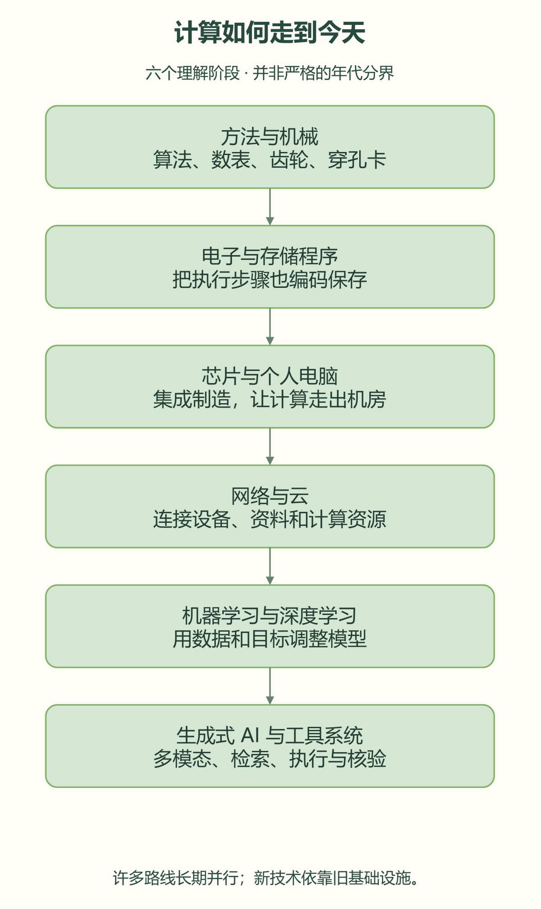
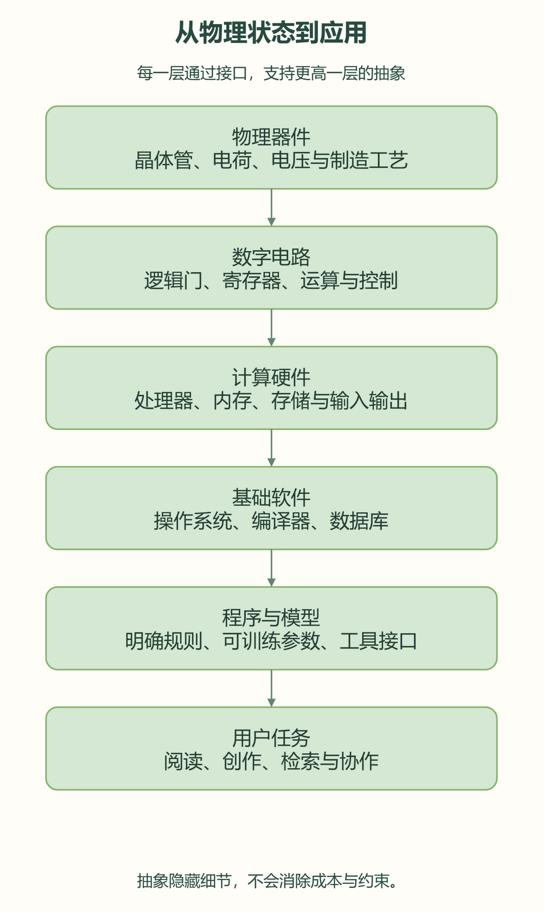
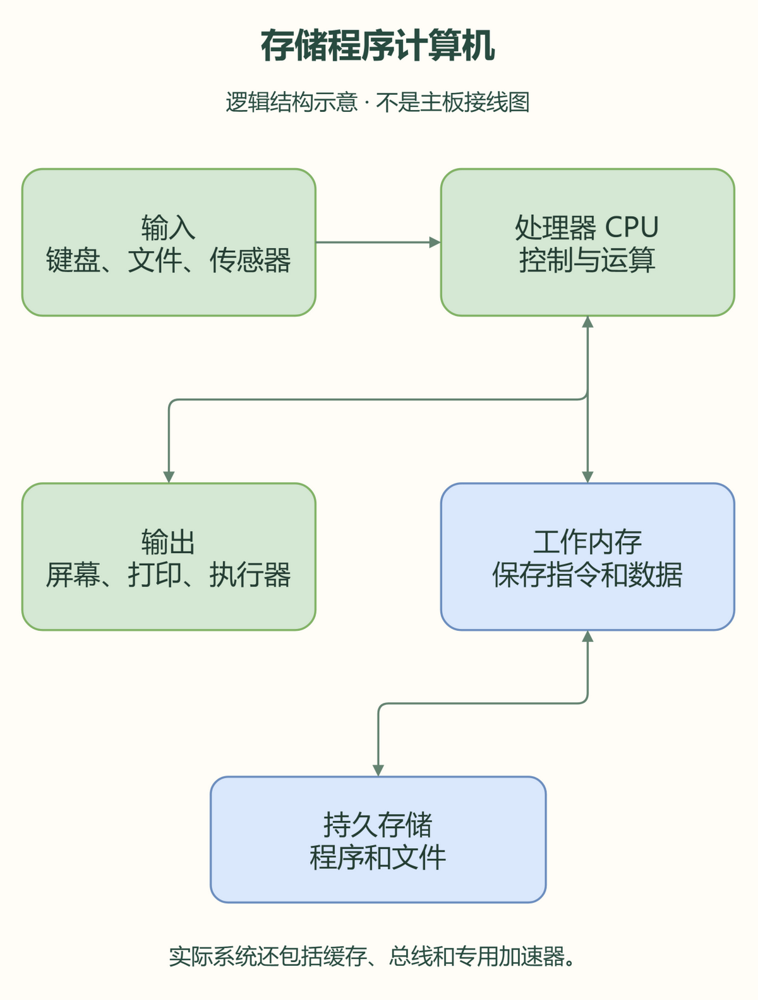
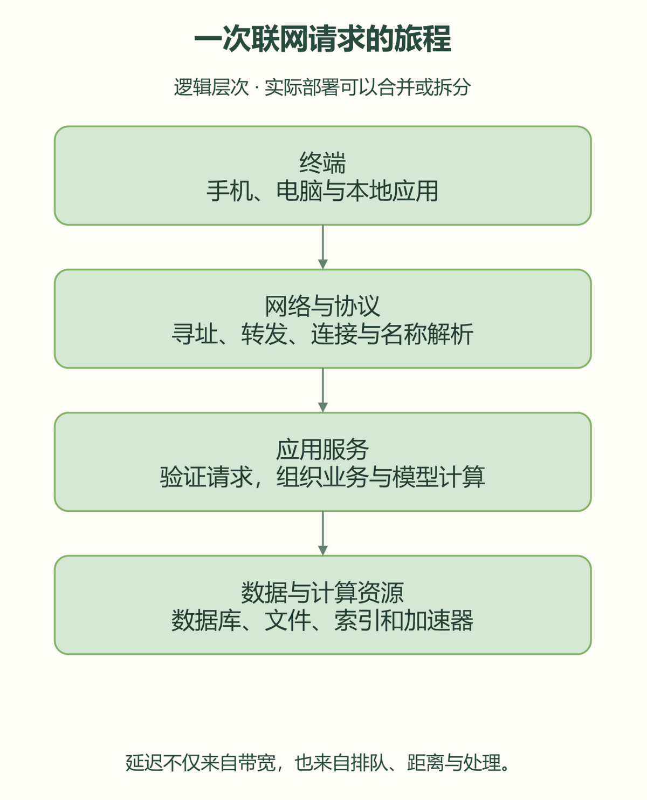
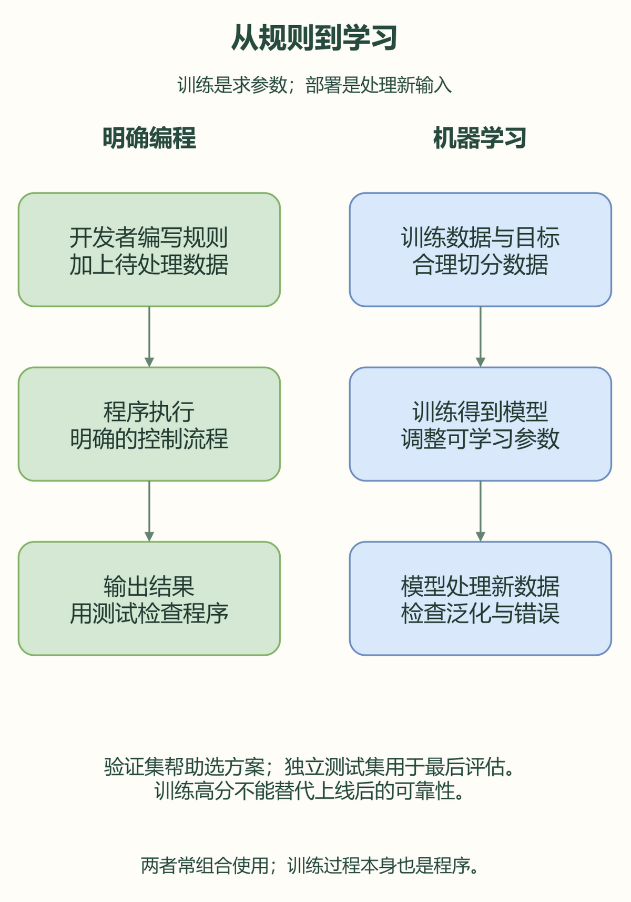
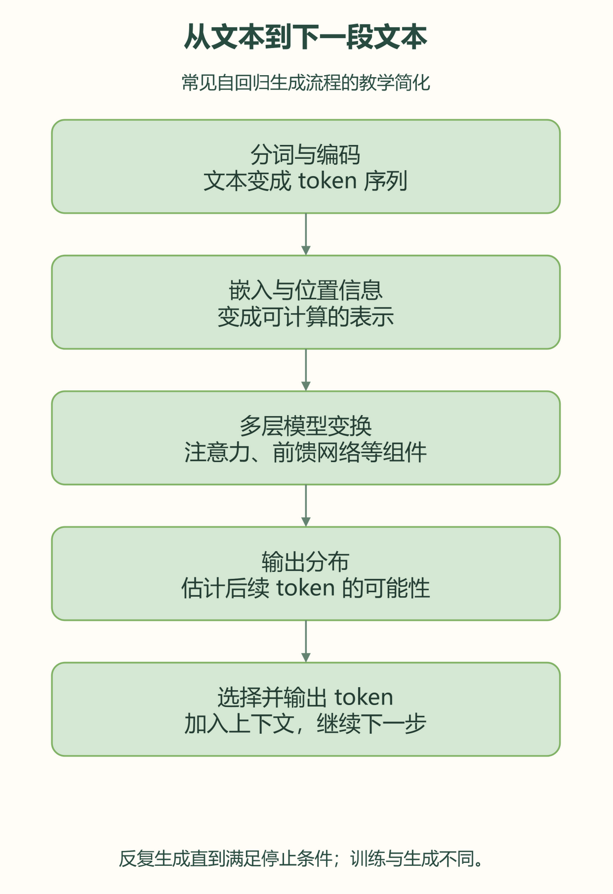
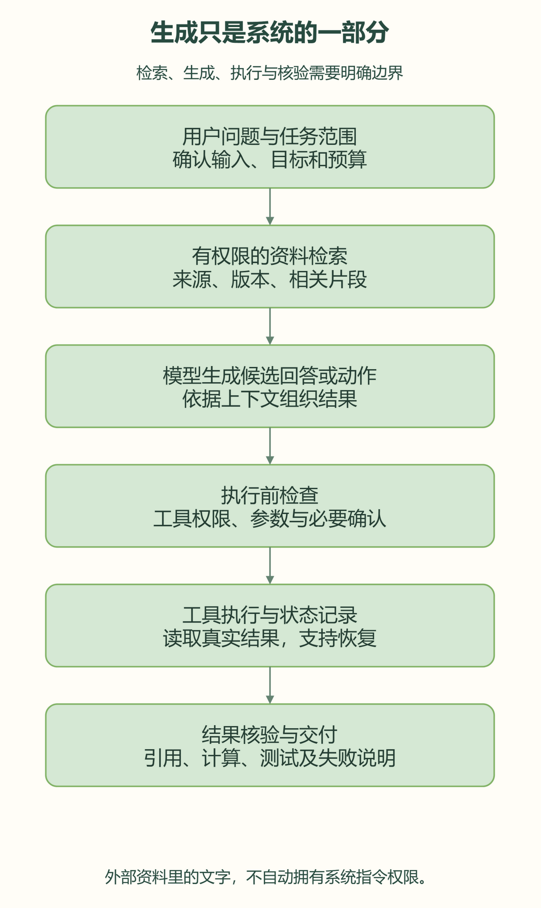
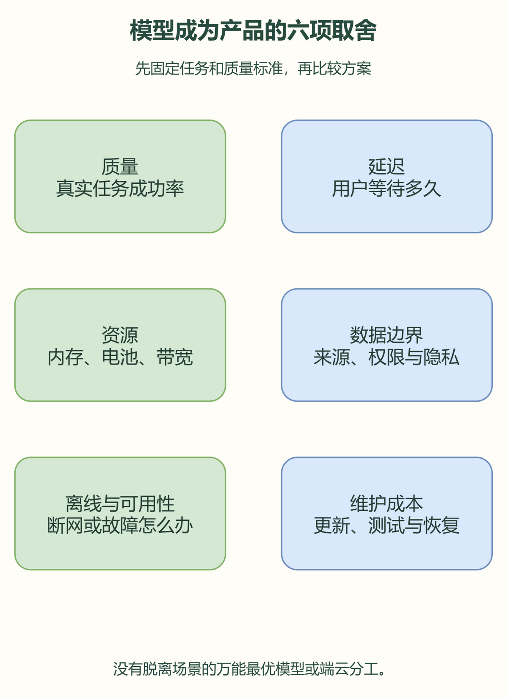

# 从计算机到人工智能：一部关于“如何让机器做事”的简史

> 从算盘、齿轮与穿孔卡，到电子计算机、互联网和大模型，人类不断把重复劳动交给机器，也不断重新思考什么是计算、知识与智能。
>
> 这是一篇可离线阅读的原创入门长文。八幅配图均为教学示意，不是历史照片，也不表示真实芯片的内部比例。文末列有博物馆资料与原始论文。整理日期：2026 年 10 月 23 日。

## 阅读路线：先抓住五条线索

如果把计算机史看成一连串产品发布，我们很容易记住名字，却弄不清为什么后一代技术会出现。换一种读法：观察人类一直在解决的五个问题。

1. **表示**：怎样把数字、文字、图像和声音，变成机器能够处理的形式？
2. **执行**：怎样让机器准确、快速地完成一串步骤？
3. **组织**：怎样把硬件、程序和数据组合成可维护的系统？
4. **连接**：怎样让不同机器共享信息、协同工作？
5. **学习**：当规则太复杂，能不能从例子中得到可用的规律？

这五条线并没有依次结束。今天的大模型仍然离不开二进制、操作系统、数据库、网络协议和芯片制造；今天的传统程序也没有因为 AI 而失效。旧技术经常成为新技术的地基。



*图一是理解路线，不是严格的年代分界。机械计算、符号推理、统计学习与神经网络曾长期并行发展。点击图片可以放大查看。*

## 一、计算机出现以前：人先把计算变成方法

### 1. 数字不仅是数量，也是可操作的表示

想象一个商人要核对几千笔货款。如果每次都依靠记忆、心算和口头传递，工作量上升时，错误也会一起上升。记数符号、位值制、算盘、计算表和标准算法的意义，就在于把个人经验变成可以重复执行、可以交叉检查的步骤。

十进制位值制用有限的符号表示很大的数；进位规则把复杂加法拆成一列列的小操作。我们在纸上做的竖式，其实已经包含“输入、状态、操作顺序、结果”这些后来程序设计的基本要素。

**算法不等于电脑程序。** 长除法的规则、寻找最大公约数的方法，都可以由人执行。计算机的特别之处，是把大量这样的步骤自动执行，并保存中间状态。算法是否正确，与执行它的人或机器够不够快，也是两个不同问题。

### 2. 机械计算：让齿轮承担重复劳动

机械计算器用齿轮位置表示数字，用啮合和转动完成加减、进位等操作。它们把计算规则写进物理结构，但改变任务往往需要改变结构或人工操作方式。

19 世纪，查尔斯·巴贝奇设计差分机，用机械方式计算并输出数表；他进一步构思分析机，把存储、运算、控制和输入输出组织到一个更通用的系统中。这些设计受到制造精度、资金和工程组织等条件限制，没有在当时按照设想完整实现。博物馆后来的重建，帮助人们理解这些构想。

艾达·洛夫莱斯围绕分析机撰写的笔记，包含对计算步骤和机器用途的重要讨论。与其只争论“第一程序员”的标签，更值得理解的是：**机器处理的可以是按规则表示的符号，而不只是做账时的数字。** 后来的音乐、图像和自然语言处理，都与这种观点相呼应。

历史资料：[计算机历史博物馆：巴贝奇机器](https://www.computerhistory.org/babbage/)。

### 3. 穿孔卡：让指令和数据可以装卸

穿孔卡通过孔的位置表达选择或信息。织机可以根据卡片组织花纹，数据处理设备可以用卡片记录和统计资料。这里有一个重要变化：不再每次重新制造机器，而是通过更换外部记录，让同一套设备处理不同内容。

卡片不是现代内存，也不是万能编程语言，但它让“可保存、可复制、可装载的指令或数据”变得具体。这条思路后来延伸为纸带、磁带、磁盘、闪存和网络下载。载体变化很大，**把信息从执行设备中分离出来**的思想一直存在。

## 二、从逻辑到电路：为什么机器喜欢 0 和 1

### 1. 二进制是一种适合工程实现的表示

现实中的电压、电流和电荷都是连续的。数字电路把一定范围的物理状态约定为逻辑 0 或逻辑 1，留出容错余地。电压稍有波动，不一定改变逻辑意义，这比要求设备精确区分很多相近状态更容易工程化。

十进制 13 可以表示为二进制 `1101`，因为它等于 `8 + 4 + 1`。这些位本身没有“整数”的天然含义；同一段位序列也可以被解释为字符、颜色、机器指令或文件的一部分。**意义来自约定、格式与上下文。**

一个 bit 是一个二进制位；一个 byte 通常是 8 个 bit。比较内存容量、文件大小和网络速率时，要区分字节与位，还要留意十进制和二进制容量前缀的区别。

### 2. 布尔逻辑把判断变成可组合的积木

布尔逻辑中的与、或、非，可以用电路实现。把简单逻辑门组合起来，就可以得到加法器、比较器、选择器、寄存器和控制电路。

| A | B | A 与 B | A 或 B |
|:---:|:---:|:---:|:---:|
| 0 | 0 | 0 | 0 |
| 0 | 1 | 0 | 1 |
| 1 | 0 | 0 | 1 |
| 1 | 1 | 1 | 1 |

关键是**简单部件可以按明确规则大量组合**。加法器组合为运算单元，运算单元配合寄存器和控制器，形成处理器的一部分；处理器再与内存、外设和软件组成完整计算系统。



*图二展示抽象层次。越往上，开发者越少直接关心电压细节；越往下，工程师越要面对能耗、时序、制造和可靠性。*

### 3. 抽象让不同层面的工程师可以协作

写应用时，我们通常不需要手工安排每个晶体管。但这不意味着底层不重要：内存不足会使应用退出，存储速度会影响加载，网络延迟会影响协作，处理器和散热会限制 AI 推理速度。

抽象不是把复杂性变没，而是约定一个边界：只要下一层遵守接口，上层就能专注自己的问题。计算机工业能够扩大，靠的正是把复杂系统拆成可协作层次的能力。

### 4. 同样的位，怎样变成文字、图片和声音

文字需要字符编码。Unicode 为字符建立统一的编码空间，UTF-8 是把这些编码表示为字节的一种方式。如果用错误的编码解读文件，字节并没有神秘消失，却可能显示为乱码。字体则负责把字符画成字形；编码与字体不能混为一谈。

数字图像可以用像素阵列表示，每个像素记录颜色信息。声音可以通过按一定频率采样、量化幅度来数字化。分辨率、采样率、色彩空间和位深，决定了表示方式的一部分，也影响数据量与质量。

压缩利用重复模式与可接受的信息取舍减少数据。无损压缩能够恢复原始数据；有损压缩则为了更小体积舍去部分信息。JPEG、PNG、音频编码与视频编码各有目标，不能只看文件后缀就比较画质或保真程度。

## 三、电子计算机：速度上来了，编程方式还要改变

### 1. 从继电器到电子管

继电器依靠机械触点切换电路；电子管让许多开关动作不再等待机械部件运动。电子化提高了计算速度，也带来了体积、功耗、发热和维护问题。

20 世纪上半叶，多条研究路线同时出现。Z3、Colossus、ENIAC 等系统有不同目标和技术特征：是否通用、是否电子化、是否二进制、是否可编程，不能混为一谈。**“第一台计算机”没有脱离定义的唯一答案。**

1946 年公开亮相的 ENIAC，是早期大型电子数字计算机的重要代表。它让人们看到大规模电子计算可以实际运作。与此同时，早期编程需要接线、设定开关和精心安排设备，换一道题有时比执行计算本身更费事。

### 2. 存储程序：把步骤也放进存储器

存储程序思想让指令和数据都能以编码形式保存在可访问的存储系统中。机器不必为每个新任务重新接线，而可以装入另一段程序，再按程序规定执行。

```text
取指令 → 解码 → 读取操作数 → 执行 → 保存结果
                           ↓
                 根据跳转条件选择下一条指令
```

这只是教学模型。现代处理器会使用流水线、缓存、乱序执行和预测等机制，真实工作过程远比这一条直线复杂，但程序仍然依赖明确的指令语义。

1948 年，曼彻斯特 Baby 运行了保存在电子存储器中的程序，是这条路线的重要里程碑。1949 年投入运行的 EDSAC，进一步展示了存储程序计算机的实用价值。相关思想和工程成果由多位研究者共同推进，不宜全部归功于某一个人。



*现代设备通常还有多级缓存、总线、专用加速器和多种存储设备，不能把这张图当作真实主板接线图。*

资料：[存储程序](https://www.computerhistory.org/revolution/story/87)、[早期计算机时间线](https://www.computerhistory.org/timeline/computers/)。

### 3. 通用不是无限，快也不是万能

通用计算机可以通过不同程序完成大量任务，但不意味着每个问题都能在现实时间内解决。某些问题输入稍微变大，搜索空间就迅速膨胀；某些问题缺少足够信息；还有问题在理论上不存在适用于所有输入的判定算法。

所以，“换一台更快的机器”只是解决问题的一种方式。改进算法、利用问题结构、允许近似结果、改变目标或增加证据，也同样重要。后来 AI 的许多突破，正是对这些选择的重新组合。

### 4. 图灵机：研究计算，不必先造一台真实机器

1936 年，图灵用一种抽象机器研究可计算性：机器具有有限规则，可以读取、改写符号并移动读写位置。它不是当时某台电脑的施工图，而是用简化模型讨论“按明确步骤计算”到底意味着什么。

通用机器能够读取另一台机器的描述并模拟它，这帮助人们理解：同一台设备为何可以通过装入不同程序承担不同任务。可计算性研究也揭示，存在不能由通用算法解决的问题。这里的“不能”，并不是再增加一点算力就会跨过去的速度障碍。

工程上还要继续问：即使可计算，需要多少时间和空间？一个穷举方案可能在理论上给出答案，实际却超出任何可承受预算。这是算法复杂性与系统资源始终重要的原因。

论文：[On Computable Numbers, with an Application to the Entscheidungsproblem](https://academic.oup.com/plms/article-abstract/s2-42/1/230/1491926)。

## 四、晶体管、集成电路与微处理器：让计算变得普遍

### 1. 晶体管改变了成本结构

1947 年贝尔实验室的晶体管成果，是半导体时代的重要起点。与电子管相比，晶体管为更小、更节能、更可靠的电子设备提供了路径。但从实验器件到产业，需要材料纯度、制造工艺、封装、测试和设计方法一起成熟。

1950 年代末，集成电路开始把多个元件及其连接集成到半导体材料上。杰克·基尔比与罗伯特·诺伊斯等人的工作，从不同方向推动了这一变化。制造更多功能，不再只靠在电路板上焊接更多分立部件。

1971 年发布的 Intel 4004，是早期商用单芯片微处理器的代表。把处理器功能集成到芯片中，降低了把计算能力嵌入各种产品的门槛，推动了计算器、控制系统、个人电脑和嵌入式设备的发展。

资料：[集成电路的发展](https://www.computerhistory.org/revolution/digital-revolution/12/276)、[计算机发展时间线](https://www.computerhistory.org/timeline/)。

### 2. 摩尔定律是产业观察，不是自然定律

摩尔定律描述了集成电路复杂度随时间增长的经验趋势。它不是“电脑永远每隔固定时间快一倍”的物理保证，更不能直接推出所有软件都会自动提速。

晶体管数量增长后，设计者可以增加缓存、核心、向量单元或专用电路；实际收益还受算法、内存带宽、并行程度、制造成本与能耗影响。频率提升受到功耗和散热约束后，多核与专用加速器的重要性进一步上升。

### 3. 为什么内存和存储必须分层

速度、容量和成本很难同时做到最好。寄存器很快但容量小；缓存靠近处理器；主内存容纳工作中的数据；固态硬盘和其他存储设备保存更大、较持久的数据。

一次读取，如果命中缓存，代价可能很低；如果需要访问远程服务器，就可能等待很久。性能优化经常是在减少搬运、重复计算和等待，而不只是增加算术运算速度。

AI 芯片也重视高带宽内存、片上缓存和互连：处理器算得再快，如果参数和中间结果送不过来，计算单元也可能在等待。

## 五、软件成为一门工程：从机器指令到操作系统

### 1. 编程语言是人与机器之间的翻译层

机器指令贴近硬件，却不容易表达复杂业务。汇编语言给指令和地址起符号名称；高级语言提供变量、函数、类型、模块和抽象结构。编译器与解释器把这些表达组织成机器可以执行的形式。

FORTRAN、COBOL、Lisp、C 等语言分别在科学计算、商业处理、符号研究和系统开发中发挥重要作用。后来的语言继续探索安全性、表达能力、并发、生态和开发效率。不存在脱离任务、约束和团队的“唯一最佳语言”。

同一个求和过程，可以从寄存器操作提升到循环，再提升到库函数。抽象节省了注意力，但也可能隐藏分配、复制和调用成本。优秀软件既需要合适的抽象，也需要在关键路径理解实际代价。

```python
def average(values):
    if not values:
        raise ValueError("至少需要一个数字")
    return sum(values) / len(values)

print(average([2, 4, 6]))  # 4.0
```

这个例子也体现工程习惯：除了正常输入，还要想清楚空集合怎么处理。计算机可以忠实执行步骤，却不会自动替开发者决定需求。

### 2. 操作系统把机器变成可共享的平台

操作系统管理进程、内存、文件、设备和权限。应用不必为每一种磁盘、键盘和显示器实现完整控制逻辑，而可以通过稳定接口使用它们。

多任务不一定意味着每个程序同时独占一个核心。系统可以在任务间调度执行；多核再让一部分任务真正并行。虚拟内存给进程提供地址空间抽象，但不会凭空增加物理内存或消除存储等待。

Unix 及其生态推广了组合小工具、文本接口和可移植系统开发等思想。开放标准、开源软件和公共工具链，让更多团队能够在共享基础上构建产品。现代 AI 也依赖编译器、数值库、操作系统和分布式框架。

### 3. 数据库与事务：把“算对一次”变成“持续可信”

演示中算对，不代表程序在多人使用、断电、失败重试和并发写入时仍然正确。数据库通过索引、事务、日志和恢复机制，帮助系统在故障与竞争中维持约定。

例如转账不能只更新一半，重复提交不能重复扣款。文档编辑器保存文件时，也必须考虑原文是否已被别人改变、写入是否完整、失败后如何恢复。

这些问题没有被 AI 消除。让 AI 调用工具执行真实操作时，它们反而更重要：语言模型可以提出动作，真正提交动作的系统仍须保证权限、幂等、事务和审计。

## 六、个人电脑：计算从机房走到书桌

### 1. 微型计算机改变了谁能使用计算

1970 年代的微型计算机和家庭电脑，把一部分计算能力带出大型机构。1981 年 IBM PC 的推出与兼容机生态的发展，是个人电脑普及的重要事件，但不是个人计算故事的起点。

电子表格、文字处理、数据库和桌面出版，让普通办公室用户直接感受到计算的价值。一个人不必先成为计算机研究员，也能用软件完成过去需要多人反复抄写、核对和排版的工作。

### 2. 图形界面改变了人与程序的关系

窗口、图标、菜单和鼠标让交互对象变得可见。图形界面来自长期研究与多方实践，并非某个商业产品突然完整发明。它降低了记忆命令的负担，也带来新的设计问题：层级是否清楚、状态是否可见、操作是否可撤销？

触摸屏把许多操作变成直接点按和手势。自然语言界面又降低了一部分表达门槛，但同一句话可以有多种解释，系统必须让用户知道它准备做什么、做到了哪一步、何时需要确认。

**界面变得自然，不意味着可以省略反馈。** 对可能丢失数据或产生外部影响的操作，清晰的状态比漂亮的回答更重要。

## 七、互联网与 Web：计算机开始组成一个世界

### 1. 互联网与万维网不是同一件事

互联网把许多网络连接成更大的网络，依靠协议分工传递数据。IP 处理寻址和分组转发；TCP 在合适场景中提供有序、可靠的字节流；DNS 帮助名称解析。电子邮件、文件传输和许多应用，不必通过网页实现。

Web 是在网络基础上组织与访问资源的一套体系。浏览器、URL、HTTP 和 HTML 让相互链接的文档更容易传播。蒂姆·伯纳斯-李于 1989 年在 CERN 提出相关构想；1993 年 CERN 开放 Web 软件，促进了它的传播。

历史资料：[CERN：万维网的诞生](https://home.cern/science/computing/the-birth-of-the-web)。

### 2. 分组交换让网络共享，但不会消除延迟

可以把网络想成许多运输节点：数据被分成片段，在链路与设备之间转发。分组交换提高了共享资源的灵活性，但到达时间仍受距离、排队、带宽、拥塞和服务端处理影响。

“下载带宽高”不等于“每次小请求都快”。如果页面串行发起许多小请求，即使每个文件不大，也可能等很久。AI 应用同样如此：检索、模型推理、工具调用和结果整理，任何一段都可能成为瓶颈。



*真实部署可能合并这些角色，也可能增加 CDN、负载均衡、消息队列和多个数据中心。*

### 3. 搜索与推荐，让“找到信息”成为计算任务

当信息数量远超个人能读完的范围时，索引、排序、相关性和推荐变得重要。系统不只是保存网页，还要决定哪些内容先被看见。

这推动了统计方法、机器学习与大规模数据工程结合。但搜索和推荐也面临偏差、冷启动、恶意操纵和评价指标失真。

优化点击率，不一定就优化了真实帮助程度；让用户停留更久，不一定让用户学得更多。**目标函数决定系统被奖励什么，而它未必等同于人的完整目标。** 这个问题在大模型时代仍然存在。

## 八、移动设备与云：算力不再只在你面前

### 1. 手机是一台受电池约束的完整计算机

智能手机结合处理器、内存、存储、传感器、网络和操作系统。位置、相机、麦克风和触控，提供了桌面时代没有如此普遍的输入方式。

但手机必须面对电池、机身温度和有限内存。服务器上可接受的算法，在手机上可能造成卡顿、发热或耗电。后台运行、图片解码、频繁唤醒和不必要的网络请求，都有真实成本。

### 2. 云计算把资源组织成服务

云计算让计算、存储和网络资源可以按服务方式获取。虚拟化和容器帮助隔离、部署与调度，分布式存储和数据库支持更大规模的数据。

云不是“没有自己的电脑”，而是把一部分计算交给别人的设备和运维系统。这样可以获得弹性和集中管理，也会引入传输延迟、费用、可用性依赖和数据边界问题。

端侧与云端通常是组合关系：手机先做轻量处理，服务器处理更重的模型；或者敏感内容留在本地，只发送必要信息。怎样分工，要看隐私、成本、响应时间、离线需求和质量要求。

### 3. 大数据首先是治理和质量问题

数据多不等于数据好。重复、缺失、错误标签、过时记录、来源混杂和权限不清，都会影响结果。机器学习还需要防止训练集和测试集“串门”，否则评估可能只是在检验模型有没有见过答案。

数据工程包括收集、清洗、版本管理、采样、权限和删除机制。许多 AI 项目花在这些环节上的精力，并不比训练模型少。

## 九、人工智能并不是大模型出现后才诞生

### 1. 从“机器能思考吗”到可研究的问题

1950 年，艾伦·图灵讨论机器智能和模仿游戏，把模糊的哲学问题转化为可以讨论的行为判据。1955 年提出的达特茅斯计划，以及 1956 年的夏季研究活动，是人工智能成为研究领域的重要标志。

AI 从一开始就不是单一技术。研究者尝试过逻辑推理、搜索、博弈、知识表示、概率方法、控制、进化计算和神经网络。不同方法关注不同问题，也经常相互借鉴。

资料：[达特茅斯：人工智能研究的起点](https://home.dartmouth.edu/about/artificial-intelligence-ai-coined-dartmouth)。

### 2. 符号主义：把知识写成明确规则

如果概念与规则比较清楚，就可以把它们表示出来，再用推理程序求解。专家系统试图把专家经验组织成规则；搜索程序在候选状态间寻找路径；规划系统安排达成目标的步骤。

其优点是某些规则容易检查与解释。困难在于现实包含例外、模糊边界和隐含知识。人能认出模糊照片里的猫，却很难列出覆盖所有照片的确定规则。

规则系统没有因此消失。编译器、约束求解器、验证系统和业务规则引擎依然重要。面对“必须严格满足条件”的部分，显式规则常常比自由生成更合适。

### 3. AI 低谷不等于所有研究停止

AI 热潮曾多次遇到算力不足、数据不足、方法局限和预期过高。资助和商业兴趣收缩时，常被称为“AI 寒冬”。这种说法便于记忆，却容易掩盖不同地区、任务和路线的差异。

1997 年 Deep Blue 在正式对抗赛中击败国际象棋世界冠军卡斯帕罗夫，是专用搜索、评价函数与高性能计算结合的代表。它不意味着机器已经具备人类的全部智能，也不意味着围棋和语言问题只要照搬棋类程序就能解决。

资料：[IBM：Deep Blue](https://www.ibm.com/history/deep-blue)。

## 十、机器学习：从编写规则，转向用例子调整模型

### 1. 学习系统与传统程序，差别在哪里

传统程序通常由开发者写出处理规则，再输入数据得到结果。机器学习先选择一种可调整的模型，用训练数据和目标函数确定参数，再处理新输入。

两者不互相排斥：训练过程本身是程序，数据管道和部署系统也是软件；学习模型只是整个系统中的一个组成部分。



*训练集调整参数，验证集选择方案，独立测试集用于最后评估。实际项目还要合理按时间、对象、机构或地域切分，防止信息泄漏。*

### 2. 一个简单模型，说明训练的结构

假设用面积估计价格，可以先尝试：`预测价格 = 面积 × w + b`。`w` 与 `b` 是可调整参数。训练时比较预测与目标，寻找总体误差较小的参数。

真实价格还受位置、时间等许多因素影响。例子的重点不是估价，而是展示训练结构：**选择表示、选择模型、定义误差、调整参数、检查新数据表现。**

```python
# 仅为演示参数更新，不是可使用的估价工具。
w, b = 0.0, 0.0
rate = 0.00001
samples = [(30.0, 60.0), (50.0, 100.0), (70.0, 140.0)]
for _ in range(200):
    dw = db = 0.0
    for x, target in samples:
        error = w * x + b - target
        dw += 2 * error * x / len(samples)
        db += 2 * error / len(samples)
    w -= rate * dw
    b -= rate * db
```

### 3. 泛化比背下来更重要

训练误差小，可能只是记住了样本。真正关心的是，面对没见过的数据是否仍然有用。过拟合、分布变化、标签偏差和数据泄漏，都会让离线成绩与实际体验分离。

“准确率 99%”也必须放在背景中理解。如果某事件本来很少发生，永远回答“没有”也可能得到很高的准确率。因此还要看召回率、精确率、错误类型、代价和不同人群上的表现。

简单模型仍然重要：数据少、可解释性重要、延迟严格或规律稳定时，更大的网络不一定优于一个合适的简单方法。

### 4. 监督、自监督和强化学习，目标信号来自哪里

监督学习使用输入与目标配对的数据，例如图片与类别、历史特征与结果。无监督方法探索数据自身结构，例如聚类。自监督学习则从数据构造训练目标，例如遮住部分内容再预测，或根据前文预测后文。

强化学习把问题组织为状态、动作、反馈和长期回报。动作会影响后续状态，奖励还可能延迟到许多步之后。它与“给每个输入写一个正确标签”的监督学习，在问题组织上不同。

这些划分有交叉，实际系统也会混用。更重要的是弄清楚反馈是否真实、是否可验证，以及优化这个反馈会不会产生不希望的副作用。不能只因为训练方法名字里有“强化”，就断定结果一定更可信。

## 十一、神经网络与深度学习：把特征也交给训练

### 1. 人工神经元是数学构件，不是完整脑细胞

一个常见人工神经元把输入乘权重、加偏置，再经过非线性函数。许多这样的构件连接成层，就能表示更复杂的关系。

“神经”是历史命名与启发来源，并不意味着这些单元完整模拟大脑。真实神经系统的生物细节、学习方式和能耗结构，远比常见人工网络复杂。

### 2. 反向传播帮助分配误差

前向计算得到预测，损失函数衡量差别，反向传播利用链式法则计算参数对损失的影响，优化器再据此调整参数。1986 年的代表论文推动了这一方法传播，但相关思想有更早历史。

可以把训练想成反复校准一台有很多旋钮的机器。比喻只帮助理解参数可调整，不代表训练必然找到最优解，也不代表每个旋钮都对应一个可命名的知识点。

论文：[Learning representations by back-propagating errors](https://www.nature.com/articles/323533a0)。

### 3. 2010 年代的突破来自多种条件汇合

更大的数据集、GPU 并行计算、训练技巧、网络结构和开放工具相互促进。2012 年 AlexNet 的图像识别成绩是标志性事件；2015 年提出的 ResNet 通过残差连接帮助训练更深的网络。

这不是“突然发现越深越好”。结构、优化、数据与预算必须适配。卷积网络利用图像局部结构；循环网络曾长期用于序列；不同方法各有计算特征和适用场景。

论文：[AlexNet](https://papers.nips.cc/paper_files/paper/2012/hash/c399862d3b9d6b76c8436e924a68c45b-Abstract.html)、[ResNet](https://arxiv.org/abs/1512.03385)。

### 4. GPU 为什么适合很多 AI 计算

CPU 擅长复杂控制流和通用任务；GPU 可以并行执行大量结构相似的运算。神经网络中的矩阵乘法，往往能利用这种并行能力。专用加速器又围绕特定数据类型和算子继续优化。

显存、内存带宽、芯片互连、通信同步和软件实现，都可能限制速度。多机训练还要交换梯度或模型状态；通信跟不上时，增加芯片不会按比例提速。

### 5. 从感知到决策：AlphaGo 为什么是另一种组合

早期感知机探索了用可调整连接实现学习的可能。后来深度网络增强了从复杂输入提取有用表示的能力，而决策任务还需要选择行动、预测后果和搜索候选。

2016 年，AlphaGo 以 4 比 1 战胜李世石，是这一组合的重要展示：策略网络帮助选择值得考虑的落子，价值网络帮助估计局面，树搜索继续探索后续可能；训练还使用了自我对弈等方法。它不是把每种棋局全部背下来，也不是单靠更快地枚举所有变化。

围棋有清楚的规则与胜负反馈；现实任务往往目标模糊、信息不全、错误代价更高。把棋类成功搬到现实，必须重新处理环境、反馈和安全约束，不能由一个比赛成绩直接外推。

资料：[DeepMind：AlphaGo 挑战赛](https://deepmind.google/research/highlighted-research/alphago/the-challenge-match)、[Cornell：感知机的早期探索](https://news.cornell.edu/stories/2019/09/professors-perceptron-paved-way-ai-60-years-too-soon)。

## 十二、语言成为数据：从词频到 Transformer

### 1. 语言模型学习条件分布

语言模型根据已有上下文，估计后续符号序列的可能性。早期方法使用词频统计和 n-gram；神经语言模型把词或子词映射为向量，再学习序列中的关系。

Token 不一定是一个汉字或一个英文单词，它可能是词、词片段、字节或其他单位。不同语言与格式的 token 数量，不能用固定字符比例准确换算。

向量是一组便于计算的数。训练会使一些语义和用法关系反映在向量及后续变换中，但它不是给每个词附上一份精确词典。同一个词在不同上下文里，所需表达也不同。

### 2. 注意力机制让上下文交换信息

阅读“把苹果放进盒子，然后把它盖上”时，人会用上下文推测“它”指什么。注意力机制提供了一类信息组合方法：某个位置根据计算得到的相关性，对其他位置的信息加权汇总。

常见 Q、K、V 可粗略理解为“我查询什么、各位置用什么特征被匹配、实际汇总什么内容”。这只是教学类比，实际实现是矩阵运算，不是三个会提问的角色。

### 3. Transformer 改善了序列建模的组织方式

2017 年《Attention Is All You Need》提出 Transformer。它利用注意力和前馈网络等组件，在训练阶段便于并行组织序列计算，成为后续许多语言与多模态模型的重要基础。



*这张图以常见自回归文本生成系统为例。原始 Transformer 包含编码器和解码器；许多生成式语言模型使用解码器路线。不同模型内部结构并不相同。*

论文：[Attention Is All You Need](https://arxiv.org/abs/1706.03762)。

### 4. 训练并行，不等于生成可以无限并行

自回归生成通常需要先得到当前输出，再继续下一步。提示词处理与逐 token 生成的计算特征不同；缓存、批处理和推测解码等技术可以优化效率，但仍受内存、延迟和质量约束。

上下文越长，需要处理与保存的信息通常越多。朴素全注意力的开销随长度增长很快；优化内核、稀疏方法、压缩、其他序列架构和检索，可以改变实际取舍，但长上下文不是完全免费的。

## 十三、从预训练模型到对话助手

### 1. 预训练形成可用于多种任务的表示

自回归模型可以从文本构造“根据前文预测后文”的目标，不需要人工给每句话写问答标签。大量样本让模型学习语言结构、风格与多种可利用的模式。

2020 年 GPT-3 论文展示了扩大语言模型后，在提示中提供少量示例就完成多类任务的能力。但**在上下文中利用示例，与实时修改参数不同**。普通对话通常不会因为一次纠正，就重新训练整个基础模型。

论文：[Language Models are Few-Shot Learners](https://arxiv.org/abs/2005.14165)。

### 2. 后训练让模型更好地适应交互要求

善于续写的模型，不一定是好助手。指令微调用示例帮助模型按要求回答；偏好学习和强化学习等方法，再利用评价信号调整输出倾向。

人类反馈、模型反馈和可验证自动反馈各有适用范围。优化奖励可能改善行为，也可能让模型利用评价机制的漏洞。“训练时奖励高”与“真实世界可靠”需要分开验证。

2022 年 InstructGPT 论文是代表研究，说明对用户意图的适应不只是把参数做大。

论文：[Training language models to follow instructions with human feedback](https://arxiv.org/abs/2203.02155)。

### 3. 聊天窗口成为日常入口

自然语言界面让用户描述目标，并通过追问修改要求。总结、翻译、写作、代码解释和资料整理，因此更容易利用模型能力。

界面相似，不代表背后功能相同。有的产品只生成文字，有的连接搜索、文件、代码执行和数据库。判断回答依据，应看系统实际用了什么来源和工具，不能只看说得多流畅。

### 4. 温度、上下文和记忆，分别意味着什么

温度等采样设置影响输出分布的选择方式，不是“智商旋钮”。更随机可能带来多样性，也可能增加不稳定；更确定也不保证正确。

上下文是当前计算能够使用的输入。长期记忆通常是产品另行保存的资料、偏好或检索记录，不等于模型拥有无限记忆。基础参数、当前上下文与外部存储，是三个不同概念。

## 十四、多模态：机器不只处理文字

### 1. 图像、声音和文字，需要不同的前处理

图像由像素及空间结构组成；声音包含随时间变化的波形；文字是离散符号。多模态系统用适合各输入的编码方式，把它们转为可以联合处理的表示，或在不同模块间建立接口。

“把图片交给 AI”不一定是先把整张图片转换成普通文字。系统可以提取视觉表示，再与语言模型交互。不同产品可能采用不同架构，不能把所有多模态系统概括为固定管线。

2023 年的 GPT-4 技术报告讨论了图像和文字输入等能力，是多模态大模型发展的一个研究节点，而不是多模态研究的起点。

资料：[GPT-4 Technical Report](https://arxiv.org/abs/2303.08774)。

### 2. 生成图片与视频，依赖对数据分布建模

生成模型通过自回归、扩散及其他路线产生图像、声音或视频。扩散类方法可以从噪声逐步构造样本，文本条件用来影响生成方向。不同方法在速度、细节、一致性与可控性之间取舍。

“像真的”不等于“发生过”。逼真的生成图片，不会自动成为历史记录或现场证据。本文选择结构示意图，正是为了把解释与史料照片分开。

### 3. 能描述场景，不等于能可靠操作现实世界

视频理解要处理时间关系和跨帧一致性；机器人还要处理感知、控制、实时反馈和物理安全约束。屏幕上一句正确描述，距离在复杂环境中稳定执行动作，还有很长的工程链条。

模型与控制系统的结合是重要方向，但不能由一段展示视频推断所有场景已经解决。需要观察失败情况、任务范围、环境限制和可重复测试。

## 十五、推理、工具与智能体：让回答连接到行动

### 1. 为什么“多想一会儿”可能有用

一些任务需要分解问题、尝试候选方案、调用程序与核验结果。给系统更多推理时的计算预算，可能改善表现；也会增加延迟和成本，不保证每次都改进。

2022 年思维链提示研究展示了中间步骤提示在特定任务中的作用。2025 年 DeepSeek-R1 报告，则是用强化学习提升推理任务表现的代表性公开研究。这些研究说明：预训练后怎样训练，回答时怎样分配计算，本身就是重要问题。

论文：[Chain-of-Thought Prompting](https://arxiv.org/abs/2201.11903)、[DeepSeek-R1](https://arxiv.org/abs/2501.12948)。

模型给出的解释未必完整反映内部计算。验证答案时，应依靠可检查的结果、运行记录、引用和测试，不能只因解释很长就相信它。

### 2. 工具调用：把一部分工作交给确定性系统

模型可以提出调用计算器、数据库或程序的结构化请求。运行环境检查参数与权限后执行，再返回真实结果，模型据此组织说明。

例如计算一千行数据的总和，可靠做法通常是读取明确数据并运行程序，而不是凭语言模式逐项心算。查询最新天气，需要实际访问来源；修改文件，需要真正写入并检查结果。

**生成一句“已经完成”，与外部世界真的发生变化，是两件事。** 好的工具系统必须保留可核验的状态，区分成功、失败、部分完成和根本未执行。

### 3. 固定工作流与智能体怎样分工

固定工作流预先规定步骤；更自主的智能体允许模型在一定范围内选择下一步。实际系统常把两者结合：高风险步骤走确定流程，开放问题交给模型规划，执行后再验证。

到本文整理时，工程关注已超出“能否调用一次模型”，转向状态保存、长任务恢复、工具接口、预算、隔离、评估和人工接管。这些问题都有成熟软件工程的影子，需要根据场景重新组合。

资料：[Building effective agents](https://www.anthropic.com/research/building-effective-agents)、[Scaling Managed Agents with stable interfaces](https://www.anthropic.com/research/managed-agents)。后者展示了把会话、执行环境和工具边界组织清楚的一种实践，并非唯一架构。

### 4. 一次可靠任务，应该有怎样的闭环

以“整理一批文档并生成目录”为例，系统先确认输入范围，然后读取文件，提取标题，生成候选目录，再检查重复项与失效链接。只有实际输出文件并确认内容后，才能报告完成。

如果工具失败，应保留已完成状态并给出明确原因，而不是把失败藏进一段流畅说明。若系统中途退出，恢复时应知道哪些步骤可以重试、哪些操作不能重复。这与传统任务调度、事务和日志系统的要求一脉相承。

## 十六、RAG：让模型查资料，而不只依赖参数记忆

### 1. 会更新的手册，应该放在哪里

假设产品手册每周更新。如果只把知识放进参数，每次变更都重新训练，维护成本可能很高，也难以追踪一句话来自哪个版本。

检索增强生成（RAG）先从外部资料找到相关片段，再把片段连同问题交给生成模型。这样更方便更新来源，也有机会给出处。但检索与生成任何一环出错，答案仍可能错误。



*图七把资料检索、生成、工具执行和核验分开。真实系统还可能有重排、缓存、审计和人工确认。箭头表示信息流，不表示所有动作都应自动获准。*

论文：[Retrieval-Augmented Generation for Knowledge-Intensive NLP Tasks](https://arxiv.org/abs/2005.11401)。

### 2. 向量检索只是检索方法之一

向量检索把问题与内容映射为向量，按相似性寻找候选。它能发现没有相同关键词的相关内容，也可能把语义相近、事实不同的段落放在一起。

关键词、元数据过滤、结构化查询、向量检索与重排经常需要组合。查询精确产品编号时，字符串匹配或数据库索引，可能比单独依赖语义相似更可靠。

### 3. 引用看起来像证据，也必须检查

引用可能不存在，也可能存在却不支持对应结论。至少要问三件事：来源是否真实可访问？内容是否对应正确版本？它是否真的支持这句话？

资料中的指令也不应自动成为系统指令。网页、邮件和文件可能包含恶意提示；执行环境需要把“读到的内容”与“有权改变系统行为的要求”分开。模型能力越强，权限边界越不能只依靠它自觉遵守。

### 4. 一个知识库回答，为什么会失败

问题可能出在资料根本缺失、文档切分丢掉上下文、检索漏掉关键段落、版本过滤错误、模型误读，或生成时越过了证据。只更换更大的模型，未必修复上游问题。

因此，调试 RAG 应沿着链路看实际输入输出：检索到了什么、为什么选它、模型究竟看到哪些片段、答案中的每个结论如何对应证据。这个方法比只盯最终回答更有帮助。

## 十七、AI 怎样落地：能力、预算和责任一起设计

### 1. 从模型成绩，走到用户真正完成任务

应用质量取决于完整链路：输入是否正确、模型是否合适、资料是否新、工具是否可靠、结果是否验证、失败后能否恢复。单个基准分数不能代替实际场景评估。

| 场景 | AI 适合承担的部分 | 仍需明确的验证 |
|:---|:---|:---|
| 长文阅读 | 摘要、比较观点、提取线索 | 回看原文，保留限定条件 |
| 编程 | 草拟实现、解释代码、提出测试 | 编译、回归测试、审查与权限检查 |
| 企业知识库 | 检索资料、组织答复 | 来源版本、权限、引用支撑关系 |
| 表格分析 | 设计步骤、解释输出 | 实际运行计算，核对口径与记录 |
| 客户服务 | 常见问题、引导和分类 | 超范围转人工，保留操作审计 |
| 创意制作 | 发散方案、生成草稿 | 事实、素材来源与最终质量审阅 |

这些是任务拆分示例，不是对任何产品的性能保证。是否使用 AI，应与简单检索、规则程序和人工流程实际比较。

### 2. 小模型、量化、蒸馏和混合专家

量化用较低精度存储或计算一部分数值，可能减少内存与带宽需求，也可能影响质量，并依赖硬件与实现。蒸馏让较小模型学习较大系统的行为，不保证所有能力完整保留。

混合专家（MoE）根据输入选择部分专家参与计算。总参数与每次激活参数需要分开理解；路由、通信和负载均衡也有代价。不能只看“参数更大”就推断实际速度、成本或能力。

缓存、批处理、推测解码、专用算子和端云协同，都是工程工具。它们没有脱离工作负载的万能最优值：低并发交互重视延迟，高并发服务还要考虑吞吐、排队和预算。



*这张图没有给出设备性能排名。模型成为产品，需要同时满足多项约束，不能只追求最大的参数量。*

### 3. 端侧不自动等于离线，云端不自动等于实时知识

端侧运行说明一部分计算在本地，不自动说明应用没有网络；云端模型依赖远端服务，也不自动说明知识实时更新。必须查清系统如何访问数据、何时联网、保存什么。

本阅读器选择本地文档优先，长文与配图可离线阅读；查看外部参考资料才需要另行打开链接。这不是所有应用的通用答案，而是与阅读工具的目标相匹配。

### 4. 评价成本时，不要只看一次调用价格

真实任务还可能包含检索、数据传输、工具执行、重试、人工复核与运维成本。便宜但经常失败的方案，最终成本可能更高；慢一些却能稳定完成的方案，也可能更适合复杂任务。

同样，端侧模型省掉部分服务请求，却消耗设备内存、电池和开发维护资源。比较方案时，应该固定同一组任务、同一质量标准与实际使用频率，记录完整成本。

## 十八、必须正视的局限：流畅、正确与可信并不相同

### 1. 幻觉不是简单的“数据库查错了”

生成模型按学到的模式与当前条件输出内容。它可能给出不存在的书名、错误引文或合理外观的细节，也可能在信息不足时继续补全。让语气谨慎，不能自动解决事实问题。

检索、工具、结构化约束与后验验证可以降低部分错误，不能保证消除全部错误。系统需要允许“证据不足”“工具失败”“需要人工判断”，而不是强迫每个请求都有确定答案。

### 2. 测试环境与真实环境可能不同

评估数据可能被污染，题目可能过于标准，某些语言与人群样本可能不足。部署后，用户表达、任务难度和数据分布也会变化。

评估应覆盖成功率、失败类型、延迟、成本和恢复能力，并保留去除敏感内容的困难案例。长任务还要检查中途断开、重复执行、错误重试和版本变更。

### 3. AI 无法绕过信息、计算和现实约束

没有测量过的事实，不会因为模型更大就自动已知；权限不足的系统，不应因为一句话要求而越权；现实操作失败，不能用一段文字宣称成功来抵消。

意识、通用智能和未来社会的具体时间表，也没有一个仅凭演示就能确认的统一结论。本文不把产品宣传或个人预测写成完成的历史事实。

## 十九、连起整条历史：新技术重新组织旧能力

再看开头的五条线索，就会发现它们一直相互推动。

- **表示更统一**：从数字和符号，到二进制文件，再到可训练的向量表示。
- **执行更便宜**：从机械动作，到电子开关、集成电路和并行加速。
- **组织更复杂**：从单段程序，到操作系统、数据库、分布式服务和工具系统。
- **连接更广泛**：从一台设备，到网络、Web、移动终端和数据中心。
- **学习更通用**：从单一任务模型，到由提示、检索和工具共同约束的生成系统。

这不是一个“人不断被机器替代”的单线故事。每代工具都会改变人的分工：哪些步骤自动化，哪些目标由人定义，哪些结果需要验证，哪些责任不能外包给接口。

你正在用的 Markdown 阅读器，就是这些层次的一次交汇：文字经过编码保存到闪存，操作系统管理文件与显示，处理器解析语法，图形系统绘制页面，网络协议负责可选外链。一篇讨论 AI 的文章，也需要这些普通基础设施才能被可靠地读到。

## 二十、时间线速查：重要节点与容易误读的地方

| 时期 | 代表节点 | 更值得记住的意义 |
|:---|:---|:---|
| 古代至近代 | 位值制、算盘、算法与数表 | 先把计算组织成可重复的方法 |
| 19 世纪 | 巴贝奇机器、洛夫莱斯笔记 | 通用执行与符号处理的构想 |
| 1930—1940 年代 | 可计算性、早期可编程机器 | 理论边界与工程相互推进 |
| 1946 | ENIAC 公开亮相 | 大规模电子计算的重要展示 |
| 1947 | 晶体管成果 | 半导体计算的重要基础 |
| 1948—1949 | 曼彻斯特 Baby、EDSAC | 电子存储程序路线的实践 |
| 1955—1956 | 达特茅斯计划与研究活动 | AI 成为明确研究议题 |
| 1950 年代末 | 集成电路 | 多元件及连接集成制造 |
| 1971 | Intel 4004 | 商用微处理器时代的代表节点 |
| 1970—1980 年代 | 微型计算机、个人电脑生态 | 计算更普遍地进入个人工作 |
| 1986 | 反向传播代表论文 | 多层网络训练方法传播 |
| 1989—1993 | Web 构想、实现与开放 | 网络信息更容易组织传播 |
| 1997 | Deep Blue 胜卡斯帕罗夫 | 专用系统在明确任务上突破 |
| 2000—2010 年代 | 移动、云与大规模数据 | 端、网、云成为日常基础设施 |
| 2012 | AlexNet | 数据、并行计算与训练结合 |
| 2015 | ResNet | 残差结构帮助训练更深网络 |
| 2016 | AlphaGo 战胜李世石 | 学习、搜索与决策相结合 |
| 2017 | Transformer | 注意力架构推动序列建模 |
| 2020 | GPT-3、RAG 代表研究 | 规模化预训练与外部检索 |
| 2022 | 指令学习、对话与思维链研究 | 模型如何适应交互更受关注 |
| 2023—2026 | 多模态、推理、工具与系统工程 | 重视质量、成本、核验和恢复 |

这是理解脉络的节点选择，不是完整发明清单，也不是国家、团队和研究路线的贡献排名。

## 附录一、二十个术语，用一句话建立直觉

| 术语 | 入门解释 |
|:---|:---|
| 算法 | 在明确条件下解决问题的一组步骤 |
| 程序 | 用语言表达、由计算系统执行的指令组织 |
| 指令集 | 处理器对软件提供的指令与行为约定 |
| 操作系统 | 管理进程、内存、文件、设备与权限的软件 |
| 内存 | 程序运行时经常访问的工作空间 |
| 缓存 | 保存可能再次使用的结果，减少昂贵访问 |
| 数据库 | 按规则组织、访问与管理数据的系统 |
| 分布式系统 | 多台通过网络通信的设备共同完成任务 |
| 模型 | 表示关系、预测或生成结果的可计算结构 |
| 参数 | 训练过程中可以调整的模型数值 |
| 训练 | 利用数据与目标函数调整模型的过程 |
| 推理 | 使用训练后模型处理输入；不只指逻辑推导 |
| 损失函数 | 衡量输出与训练目标差别的规则 |
| 泛化 | 在未直接用于训练的新情形中仍有效 |
| 嵌入 | 把内容映射为便于计算的向量表示 |
| Token | 分词或编码系统使用的一种基本单位 |
| 上下文 | 当前模型计算可以利用的输入信息 |
| RAG | 将资料检索与生成模型结合的系统方法 |
| 量化 | 以较低精度表示或计算，改变资源与质量取舍 |
| 智能体 | 在一定边界内选择步骤并调用工具的系统 |

## 附录二、十个问题：检查自己是否真正理解

### 1. 为什么图片也能存成 0 和 1？

因为系统约定了尺寸、像素、颜色或压缩结构怎样编码为位序列。位序列本身不是图片，需要符合格式的解码过程才能恢复图像表示。

### 2. CPU 越快，应用都会同比变快吗？

不会。程序可能等磁盘、网络、锁或内存，也可能只有少量工作能并行。先识别瓶颈，再决定优化什么。

### 3. 互联网就是浏览器里的网页吗？

不是。Web 是网络基础之上的重要应用体系；电子邮件、许多游戏协议与其他服务也使用互联网。

### 4. 机器学习就是不用编程吗？

不是。模型、训练、数据处理、评估、部署和工具接口都需要程序；改变的是部分规则通过数据和目标函数得到。

### 5. 训练成绩好，为什么上线还出错？

可能过拟合、数据泄漏、样本偏差、目标选择不当，或者上线输入与训练分布不同。也可能是模型以外的数据、网络与工具出了问题。

### 6. 模型能说出知识，说明内部有精确数据库吗？

不能这样推断。参数中的模式，与带版本、权限和精确检索接口的数据库，不是同一种存储机制。

### 7. 有联网与检索，就不会出事实错误吗？

不会。检索可能找错资料，资料可能过时，模型也可能误读或引用不支持结论的来源。

### 8. 解释越长，一定越可靠吗？

不一定。长过程可能帮助某些任务，也可能把错误包装得更完整。需要核验事实、计算、测试和执行记录。

### 9. 开放权重，与完整开源软件相同吗？

不一定。权重、代码、数据、训练配方和使用条款是不同材料，开放范围与许可需要分别查看。

### 10. 下一代技术会让基础软件工程过时吗？

不能由模型能力进步直接推出。越复杂、越能执行动作的系统，越需要接口、可靠存储、隔离、测试、监测和恢复。

## 附录三、四周学习小计划

下面复选框可以用作本地阅读记录，没有任何外部提交。

- [ ] 第一周：练习进制转换，画一个输入、处理、输出的小程序。
- [ ] 第一周：观察手机应用怎样读文件、使用内存、等待网络。
- [ ] 第二周：学习变量、条件、循环和函数，修改平均数例子。
- [ ] 第二周：解释操作系统、数据库、互联网和 Web 的区别。
- [ ] 第三周：用可公开的小数据集做统计，再尝试简单预测模型。
- [ ] 第三周：划分训练与测试数据，比较简单基线和复杂方案。
- [ ] 第四周：比较纯模型回答、带资料回答和实际工具计算。
- [ ] 第四周：追查一次错误究竟来自数据、检索、模型还是工具。

目标不是背完名词，而是遇到方案时能问：它解决什么问题？依靠什么证据？有什么边界？失败后怎么办？

## 参考资料与配图说明

本文是原创综合讲解，未复制来源图片、长段文字或论文插图。以下资料供核对节点和继续学习；类比、系统拆分与教学例子由本文组织，不是逐句翻译。外链内容可能更新，正文与配图不依赖网络。

1. [CHM：The Babbage Engine](https://www.computerhistory.org/babbage/)。机械计算与通用机器构想。
2. [CHM：Computers Timeline](https://www.computerhistory.org/timeline/computers/)。早期电子计算与个人电脑节点。
3. [CHM：The Stored Program](https://www.computerhistory.org/revolution/story/87)。存储程序思想与实现。
4. [CHM：The Integrated Circuit](https://www.computerhistory.org/revolution/digital-revolution/12/276)。集成电路。
5. [CERN：The birth of the Web](https://home.cern/science/computing/the-birth-of-the-web)。Web 的研究起源与开放。
6. [Dartmouth：Artificial Intelligence Coined at Dartmouth](https://home.dartmouth.edu/about/artificial-intelligence-ai-coined-dartmouth)。AI 领域形成。
7. [IBM：Deep Blue](https://www.ibm.com/history/deep-blue)。专用博弈系统。
8. [Rumelhart 等，1986：Learning representations by back-propagating errors](https://www.nature.com/articles/323533a0)。反向传播。
9. [Krizhevsky 等，2012：ImageNet Classification with Deep Convolutional Neural Networks](https://papers.nips.cc/paper_files/paper/2012/hash/c399862d3b9d6b76c8436e924a68c45b-Abstract.html)。AlexNet。
10. [He 等，2015：Deep Residual Learning for Image Recognition](https://arxiv.org/abs/1512.03385)。ResNet。
11. [Vaswani 等，2017：Attention Is All You Need](https://arxiv.org/abs/1706.03762)。Transformer。
12. [Brown 等，2020：Language Models are Few-Shot Learners](https://arxiv.org/abs/2005.14165)。GPT-3。
13. [Lewis 等，2020：Retrieval-Augmented Generation for Knowledge-Intensive NLP Tasks](https://arxiv.org/abs/2005.11401)。RAG。
14. [Ouyang 等，2022：Training language models to follow instructions with human feedback](https://arxiv.org/abs/2203.02155)。指令与人类反馈。
15. [Wei 等，2022：Chain-of-Thought Prompting Elicits Reasoning in Large Language Models](https://arxiv.org/abs/2201.11903)。中间步骤提示。
16. [OpenAI，2023：GPT-4 Technical Report](https://arxiv.org/abs/2303.08774)。多模态节点。
17. [DeepSeek-AI，2025：DeepSeek-R1](https://arxiv.org/abs/2501.12948)。强化学习与推理。
18. [Anthropic：Building effective agents](https://www.anthropic.com/research/building-effective-agents)。工作流与智能体。
19. [Anthropic：Scaling Managed Agents with stable interfaces](https://www.anthropic.com/research/managed-agents)。长任务系统的工程实践。
20. [Turing，1936：On Computable Numbers](https://academic.oup.com/plms/article-abstract/s2-42/1/230/1491926)。可计算性与抽象机器。
21. [DeepMind：AlphaGo Challenge Match](https://deepmind.google/research/highlighted-research/alphago/the-challenge-match)。学习与搜索结合。
22. [Cornell：Professor’s perceptron paved the way for AI](https://news.cornell.edu/stories/2019/09/professors-perceptron-paved-way-ai-60-years-too-soon)。早期学习机器。

**配图与许可**：八幅图为纸墨Markdown项目原创教学示意，编辑源文件位于仓库 `docs/illustrations/`，图片随应用打包。本文、配图及图源随项目采用 MIT 许可；外链内容仍按各自权利人的条款使用。

---

> 从齿轮到芯片，从程序到模型，技术不断改变的是机器能承担的步骤；始终需要人认真回答的，是我们希望完成什么，以及怎样知道它真的完成了。
